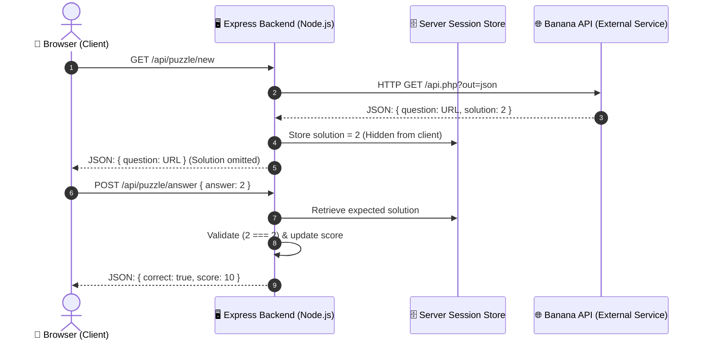

# 🍌 Banana Puzzle Challenge (Distributed Web Application)

**Course:** CIS046-3 Software for Enterprise  
**Assessment:** Assignment 1 (Distributed Architecture & Four Enterprise Themes)  
**Author:** Individual Assignment  

---

## 📖 Project Overview

The **Banana Puzzle Game** is an interactive, distributed web application built with **Node.js, Express, HTML5, CSS3, and JavaScript**. It communicates with Marc Conrad's external **Banana Puzzle API** to serve mathematical visual logic puzzles to players, securely validates user answers on the server side, tracks virtual identities through session state, and handles network disruptions with error handling and fallback mechanisms.

---

## 🏛️ The Four Required Enterprise Themes

| Theme | Implementation in this Project | Code Location / Evidence |
| :--- | :--- | :--- |
| **1. Version Control** | Initialized Git from Day 1. Granular, meaningful commit history tracking architectural milestones. | `.git/`, Git commit log, GitHub repository. |
| **2. Interoperability** | Node.js backend communicates over HTTP REST with Marc Conrad's external Banana API. Includes mirror failover, request timeouts, and error handling. | [`src/banana.service.js`](src/banana.service.js) |
| **3. Event-Driven Programming (EDP)** | Frontend event listeners capture button clicks, form submissions, numpad inputs, keyboard shortcuts, and dynamic DOM updates. | [`public/game.js`](public/game.js) |
| **4. Virtual Identity** | Server-side sessions (`express-session`) manage player profiles, authentication state, roles (player vs admin), and keep puzzle solutions secure on the server. | [`src/server.js`](src/server.js) |

---

## 📐 Distributed System Architecture



### Why the Solution Stays on the Backend
In a naive single-tier application, fetching the Banana API directly from the browser would expose `solution` in client-side network tools or JavaScript variables (inspect element cheating). By using our **Express server as a proxy and validation authority**, the client never learns the solution until after an answer is submitted.

---

## 📡 External Banana API Reference

- **Official API Documentation:** [https://marcconrad.com/uob/banana/doc.php](https://marcconrad.com/uob/banana/doc.php)
- **Primary Endpoint:** `http://marcconrad.com/uob/banana/api.php?out=json`
- **Mirror Endpoint:** `https://www.sanfoh.com/uob/banana/api.php?out=json`

### Sample Actual Response:
```json
{
  "question": "https://www.sanfoh.com/uob/banana/data/t1d12974cf5ff970d3e50437818n62.png",
  "solution": 2
}
```

---

## 🚀 Setup & Running Locally

### 1. Prerequisites
- **Node.js** (v18.0.0 or higher)
- **npm** (Node Package Manager)
- **Git**

### 2. Installation
Clone the repository and install dependencies:
```bash
cd banana-puzzle-game
npm install
```

### 3. Start the Server
For development with automatic restarts:
```bash
npm run dev
```

Or standard production start:
```bash
npm start
```

### 4. Play the Game
Open your web browser and navigate to:
```
http://localhost:3000
```

---

## 🧪 Testing Error Scenarios (Assignment Requirement)

To fulfill the requirement: *"Test a failure or unavailable-service scenario"*:
1. Click the **"⚡ Simulate API Failure: OFF"** button in the top system ribbon to toggle failure simulation on.
2. Click **"New Puzzle"** or **"Start Game"**.
3. Observe how the application gracefully catches the failure, displays a clear warning to the user, and offers an **"Offline Fallback"** option so gameplay is never broken.
